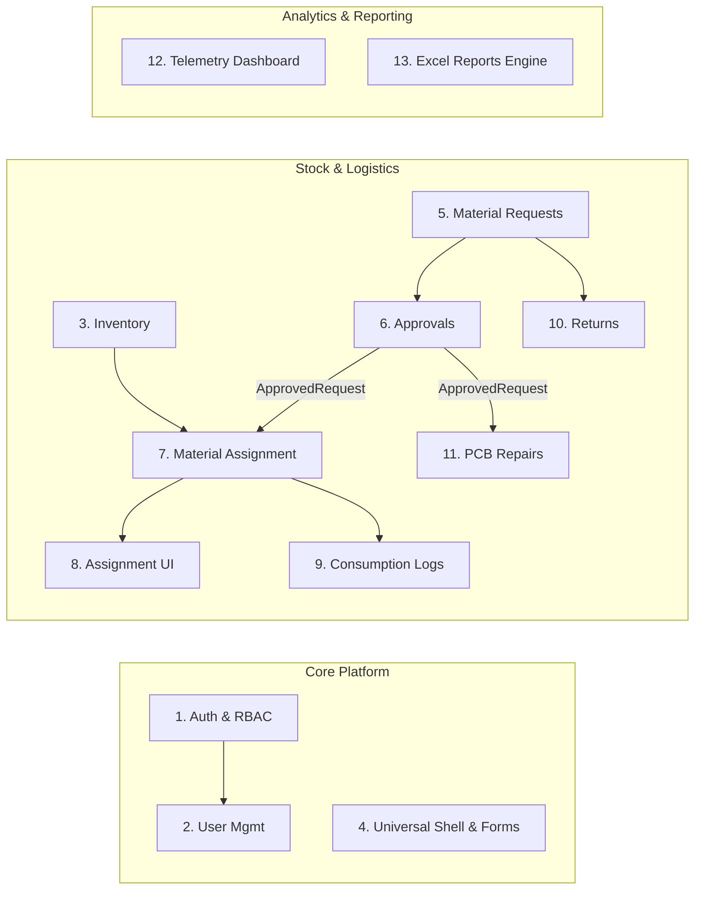
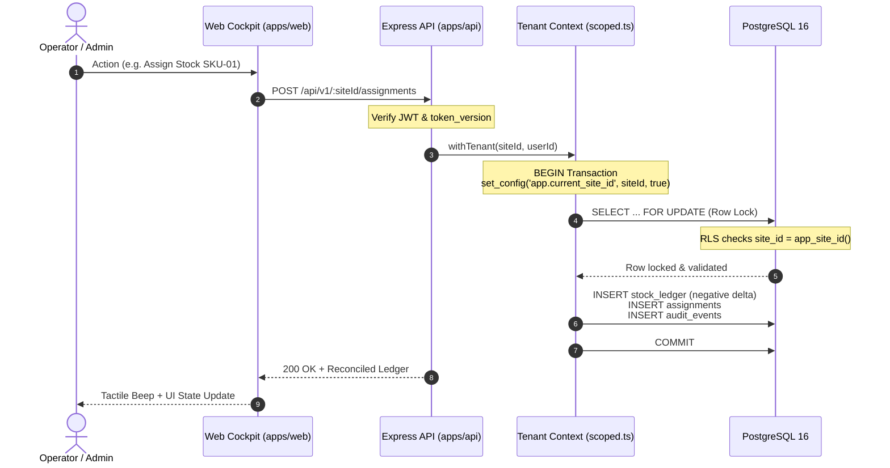

<div align="center">

# ⚡ OPSHUB
### **Autonomous Enterprise Operations & Fleet Command Platform**

[](#-license)
[](#-the-paradigm-shift)
[](#-security--tamper-resistance)
[](#-testing--architectural-invariants)
[](#-design-system-devfest-neo-brutalism)

<br/>

> **"Three operational units used to mean 36 disparate implementations. We engineered 13 typed modules once — and pure configuration orchestrates the rest."**
> 
> *OpsHub is to mission-critical industrial operations what Shopify is to e-commerce, combined with Vercel-style atomic preview, compile, publish, and time-travel rollback.*

<br/>

<!-- Tech Stack Icons from skillicons.dev -->
<p align="center">
  <a href="https://skillicons.dev">
    
  </a>
</p>

</div>

---

## 📑 Table of Contents

- [⚡ Executive Summary](#-executive-summary)
- [🧩 The Paradigm Shift: Universal Runtime](#-the-paradigm-shift-universal-runtime)
- [🎨 Design System: DevFest Neo-Brutalism](#-design-system-devfest-neo-brutalism)
- [💎 Signature Innovations (S1–S5)](#-signature-innovations-s1s5)
- [🎛️ Command HUD, Barcode & Real-Time Telemetry](#️-command-hud-barcode--real-time-telemetry)
- [📦 The 13 Core Modules & Subtype Chain](#-the-13-core-modules--subtype-chain)
- [🏗 Architecture & Data Flow](#-architecture--data-flow)
- [🛡 Security, Tenant Isolation & Concurrency](#-security-tenant-isolation--concurrency)
- [🧪 Testing & Architectural Invariants](#-testing--architectural-invariants)
- [🚀 Quickstart Guide](#-quickstart-guide)
- [🔑 Pre-Seeded Fleet Credentials](#-pre-seeded-fleet-credentials)

---

## ⚡ Executive Summary

Traditional operations software across distributed warehousing, repair depots, and logistics fleets suffers from systemic code duplication: **Central Stores**, **Service Centres**, and **Distribution Hubs** often spin up separate apps with their own logins, uncoordinated schemas, and fragile forms.

**OpsHub eliminates this through a dual-core architecture:**
1. **The Brain (Configuration Engine):** Validates, compiles, and commits immutable JSONB release definitions containing layout structures, role matrices, calculation formulas, and state machines.
2. **The Universal Body (Runtime Shell):** A single, ultra-performant React client and generic REST API that renders and executes any operational workflow purely from active release pointers — with **zero hardcoded `if (site === 'x')` branching**.

---

## 🧩 The Paradigm Shift: Universal Runtime

| Traditional Operations Platforms | ⚡ OpsHub Universal Runtime |
| :--- | :--- |
| **36 Codebases for 3 Sites**: 12 shared modules duplicated across every operating unit. | **1 Codebase, 13 Typed Modules**: One universal renderer maps JSON release schemas into live workspaces. |
| **Code Changes to Alter Fields**: Adding a custom bin or cost code requires redeploying APIs and databases. | **Pure JSONB Schema Fields**: Typed core columns + dynamic schema-validated fields that compile on the fly. |
| **Destructive Database Alterations**: Upgrades alter or drop live columns, risking historical records. | **Soft-Hide Semantics**: Removing a field soft-hides it; data remains intact and historical releases validate. |
| **Server Restarts for Releases**: New workflows require downtime or rolling cluster updates. | **Atomic Pointer Flips**: A site is an active release pointer (`v1 ➔ v2`). Publishing takes `<10ms` with zero downtime. |
| **No Cross-Site Rollbacks**: Reverting a mistake requires manual database restores or migrations. | **Time-Travel Release Rewind**: Drag a time slider to preview and atomically revert any release in-flight. |

---

## 🎨 Design System: DevFest Neo-Brutalism

OpsHub rejects sterile enterprise gray in favor of a tactile, high-contrast, industrial aesthetic inspired by **Google DevFest Neo-Brutalism**:

<div align="center">

| Token | Hex | Role | Visual Indicator |
| :--- | :--- | :--- | :--- |
| **DevFest Yellow** | `#FBBC04` | Primary Focus, Warning Accents, Highlights | <kbd>&nbsp;&nbsp;&nbsp;&nbsp;&nbsp;&nbsp;&nbsp;&nbsp;</kbd> |
| **Google Blue** | `#4285F4` | Command HUD, Links, Action Buttons | <kbd>&nbsp;&nbsp;&nbsp;&nbsp;&nbsp;&nbsp;&nbsp;&nbsp;</kbd> |
| **Signal Red** | `#EA4335` | SLA Breach, Rejections, Critical Alerts | <kbd>&nbsp;&nbsp;&nbsp;&nbsp;&nbsp;&nbsp;&nbsp;&nbsp;</kbd> |
| **Fresh Mint** | `#34A853` | Ledger Balanced, Approvals, Success Badges | <kbd>&nbsp;&nbsp;&nbsp;&nbsp;&nbsp;&nbsp;&nbsp;&nbsp;</kbd> |
| **Ink Obsidian** | `#090D16` | Cyber Dark Mode Background, High-Contrast Canvas | <kbd>&nbsp;&nbsp;&nbsp;&nbsp;&nbsp;&nbsp;&nbsp;&nbsp;</kbd> |

</div>

- **2.5px Hard Linework**: High-contrast outline borders (`border-[2.5px] border-slate-900 dark:border-slate-800`).
- **Tactile Offset Shadows**: Retro 3D box shadows (`shadow-[4px_4px_0px_#090D16]`) that depress on click (`active:translate-x-[2px] active:translate-y-[2px] active:shadow-none`).
- **Dual Visual Modes**: Seamless toggle between tactile **Blueprint Paper Mode** and **Cyber Deep OLED Dark Mode** with neon glowing state indicators.
- **Micro-Interactions**: Monospaced timestamp tags, acoustic Web Audio synthesizer scan beeps (`880Hz ➔ 1760Hz`), and live radar blips.

---

## 💎 Signature Innovations (S1–S5)

OpsHub implements 5 signature platform experiences designed to showcase deep architectural resilience:

```
┌───────────────────────────────────────────────────────────────────────────────┐
│                          OPSHUB SIGNATURE SUITE                               │
├─────────────────┬──────────────────┬─────────────────┬────────────────────────┤
│ S1: REWIND      │ S2: TRUST        │ S3: BOLO & BUILD│ S4: DEAD-ZONE          │
│ Time Slider     │ Cryptographic    │ Voice & NL      │ Offline PWA            │
│ Schema Rewind   │ RLS Proof Suite  │ Graph Synthesizer│ IndexedDB Pre-Warmed  │
└─────────────────┴──────────────────┴─────────────────┴────────────────────────┘
```

### ⏳ S1: Release Rewind & Time-Travel Slider
- **Visual Time Slider**: Scrub backwards through chronological release history. The live UI seamlessly morphs into the historical configuration in read-only mode.
- **Impact-Aware Pre-Flight Report**: Before publishing or rolling back, a semantic diff engine reports the exact blast radius: *"Hides field 'cost_centre' (412 rows hold data; values preserved), adds Returns module, 14 active requests keep running under v5"*.
- **Atomic Pointer Reversal**: Rollback simply updates the site's `active_release_id` pointer. **Business tables are never destructively modified.**

### 🛡️ S2: Cryptographic Trust Console
- **Verifiable RLS Isolation Proof**: Tests tenant boundaries in real time. Demonstrates that queries with zero `WHERE` clause in application code return exactly the tenant's slice through PostgreSQL Row-Level Security.
- **50-Worker Parallel ACID Proof**: Fires 50 concurrent transactions competing for 10 stock items. Proves **exact 10 allocations, 40 clean rejections, 0 stock remaining, and 100% ledger reconciliation** without deadlocks.
- **Audit Decision Drawer**: *"Why was I blocked?"* deep inspection drawer surfacing real-time rule evaluations, input parameters, and config version pinning.

### 🎙️ S3: Bolo & Build (Voice & NL Workflow Synthesizer)
- **Natural Language & Voice Input**: Speak or type procedural operations (e.g. *"Create a PCB Repair workflow with technician approvals and auto-reconciliation"*).
- **Subtype-Aware Graph Synthesis**: Employs an LLM intent pipeline that emits strictly validated Zod AST config patches.
- **3-Round Auto-Repair Loop**: Automatically catches graph cycle errors or broken node dependencies and self-heals before human review.

### 📴 S4: Dead-Zone Lite (Offline PWA Engine)
- **Zero-Latency IndexedDB Warm-Up**: Pre-caches entire application shells and active tenant tables into local browser storage on boot.
- **Resilient Fallback Mode**: Instantly detects air-gapped or network-dead conditions, displaying an offline status banner while allowing full navigation and inspection.
- **Queue & Sync**: Queues inventory scans and consumption logs with client-generated idempotency keys, replaying them to `/api/:siteId/sync` once reconnected.

### ⚡ S5: One-Save Provisioning
- **One-Click Site Genesis**: Spin up an entirely new operational site (e.g., Regional Logistics Base) from pre-configured module graph blueprints.
- **Live Event Stream**: Real-time terminal log displaying atomic step completion: table validation ➔ release compilation ➔ permission mapping ➔ automated security probe (`200 OK` for assigned admin, `403 Forbidden` for other tenants).

---

## 🎛️ Command HUD, Barcode & Real-Time Telemetry

```
┌────────────────────────────────────────────────────────────────────────┐
│ [⌘K Global HUD] ───► Instant Fleet Switcher, Actions, Diagnostic Radar │
├────────────────────────────────────────────────────────────────────────┤
│ [Optical Scanner] ──► Animated Laser Viewfinder + Web Audio Feedback   │
├────────────────────────────────────────────────────────────────────────┤
│ [QR Code Engine] ──► Industrial Vector SVGs for Thermal Bins & Pallets │
├────────────────────────────────────────────────────────────────────────┤
│ [SLA Telemetry]  ──► Aging Countdown Rings, Breaches, KPI Gauges       │
└────────────────────────────────────────────────────────────────────────┘
```

- **⌘K / Ctrl+K HUD Command Palette**: Global launcher available anywhere. Instant fuzzy navigation between sites, modules, scanner viewports, and audit logs.
- **Optical Barcode & QR Code Suite**: Full-screen camera viewfinder with sweeping animated targeting laser, Web Audio API acoustic feedback (`880Hz ➔ 1760Hz`), and instant thermal printable vector SVGs with coordinates (`Aisle-04 / Bin-12`).
- **Real-Time Telemetry Radar**: Slide-out drawer broadcasting fleet-wide live dispatch ticks, low-stock warnings, approval deadlines, and SLA breach monitors.
- **Configurable SLA Breach Rings**: Circular countdown timers monitoring pending approvals with explicit status badges:
  - 🟢 **ON TRACK** (`> 50% time left`)
  - 🟡 **NEARING BREACH** (`< 20% time left`)
  - 🔴 **CRITICAL BREACH** (`Time Expired / Overdue`)

---

## 📦 The 13 Core Modules & Subtype Chain

OpsHub organizes operational capabilities into **13 strongly-typed nodes**. The compiler validates input/output contracts, ensuring impossible operational graphs cannot be published:



> **Subtype Rule:** `ApprovedRequest` is a strict subtype of `RequestRecord`. Nodes that require an approved request (such as **PCB Repairs** or **Material Assignment**) will mathematically reject unapproved request inputs at compile time.

---

## 🏗 Architecture & Data Flow



### Monorepo Structure

```
opshub/
├── apps/
│   ├── api/                     # Express 5 + Drizzle ORM backend
│   │   ├── src/
│   │   │   ├── compiler/        # AST graph validator, Zod schema compiler, jsep
│   │   │   ├── db/              # Migrations, seeders, and scoped tenant context
│   │   │   ├── middleware/      # RLS injector, rate limiters, token revoker
│   │   │   └── routes/          # Auth, sites, releases, ops, builder, trust
│   │   └── dist/                # Production build artifacts
│   │
│   └── web/                     # React 18 + Vite universal runtime
│       ├── src/
│       │   ├── components/      # DevFest Neo-brutalist primitives, HUD, Scanner
│       │   ├── features/        # Hub, Builder, Trust Console, Provisioning, Releases
│       │   ├── runtime/         # Universal SiteShells (Sidebar, Workbench, Topbar)
│       │   └── stores/          # Zustand state (activity radar, theme, offline cache)
│       └── tests/               # 97 Vitest unit & architecture invariant tests
│
└── packages/
    └── contracts/               # Single source of truth: Zod schemas & TypeScript types
```

---

## 🛡 Security, Tenant Isolation & Concurrency

- **Two-Tier Role Model**:
  - `opshub_admin`: Database migration & seed administrator.
  - `opshub_app`: Least-privilege runtime application user (`LOGIN`, `NOSUPERUSER`, `NOBYPASSRLS`).
- **PostgreSQL Row-Level Security (RLS)**:
  ```sql
  ALTER TABLE inventory_items ENABLE ROW LEVEL SECURITY;
  ALTER TABLE inventory_items FORCE ROW LEVEL SECURITY;
  CREATE POLICY tenant_isolation ON inventory_items
    USING (site_id = nullif(current_setting('app.current_site_id', true), '')::uuid);
  ```
- **Append-Only Immutability Triggers**:
  ```sql
  CREATE TRIGGER stock_ledger_append_only
    BEFORE UPDATE OR DELETE ON stock_ledger
    FOR EACH ROW EXECUTE FUNCTION forbid_mutation();
  ```
- **Session Revocation Guard**: Bumping `users.token_version` on password reset or logout instantly invalidates issued JWTs across the cluster within 5 seconds.

---

## 🧪 Testing & Architectural Invariants

OpsHub includes an automated suite of **137 unit, integration, and architecture tests**:

```bash
# Run web client test suite (97 tests)
npm --prefix apps/web run test:unit

# Run backend API test suite (40 tests)
npm --prefix apps/api run test:unit
```

### 🔒 Invariant Guarantee: Zero Hardcoded Site Slugs
OpsHub incorporates an AST-based architectural test (`apps/web/tests/architecture.test.ts`) that parses every single TypeScript/TSX file in the frontend. It asserts that seeded site slugs (`"central-stores"`, `"service-centre"`, `"distribution"`) never appear in rendering logic, route guards, or conditionals:

```
✓ apps/web/tests/architecture.test.ts
  ✓ Architecture Invariant: No hardcoded site slugs in rendering code (0 matches found)
  ✓ Registry Invariant: All 13 modules correctly mapped to typed schemas
```

---

## 🚀 Quickstart Guide

### Prerequisites
- **Node.js**: `>= 20.0.0`
- **npm**: `>= 10.0.0`
- **Supported OS**: Windows, macOS, Linux

### 1. Clone & Install
```bash
git clone https://github.com/theanarchist123/navi.git opshub
cd opshub
npm install
```

### 2. Launch Development Stack
```bash
# Terminal 1: Embedded Zero-Config PostgreSQL (seeds automatically)
npm run db:embedded

# Terminal 2: Full Development Environment (API + Web)
npm run dev
```

- **Frontend Cockpit**: [http://localhost:5173](http://localhost:5173)
- **Backend API Server**: [http://localhost:4000](http://localhost:4000)

---

## 🔑 Pre-Seeded Fleet Credentials

The embedded and cloud databases are pre-populated with tiered demo personas:

| Role | Email | Password | Access Scope |
| :--- | :--- | :--- | :--- |
| **Platform Admin** | `admin@opshub.local` | `opshub-dev-1` | Global Fleet, Site Genesis, Trust Console, Visual Builder |
| **Storekeeper** | `storekeeper@opshub.local` | `opshub-dev-1` | Central Stores, Stock Intake, Optical Scanning, Ledgers |
| **Technician** | `technician@opshub.local` | `opshub-dev-1` | Service Centre, PCB Repairs, Return Restocking |
| **Approver** | `approver@opshub.local` | `opshub-dev-1` | Workflow Approvals, SLA Breaches, Dispatch Releases |
| **Dispatcher** | `dispatcher@opshub.local` | `opshub-dev-1` | Distribution Unit, Material Assignments, Consumption |

---

<div align="center">

### Built with precision for **Genesis 2.0 · PS-03 · Team Pookie_commits**

[](https://github.com/theanarchist123/navi)
[](#)

MIT © 2026 OpsHub Platform. All rights reserved.

</div>
